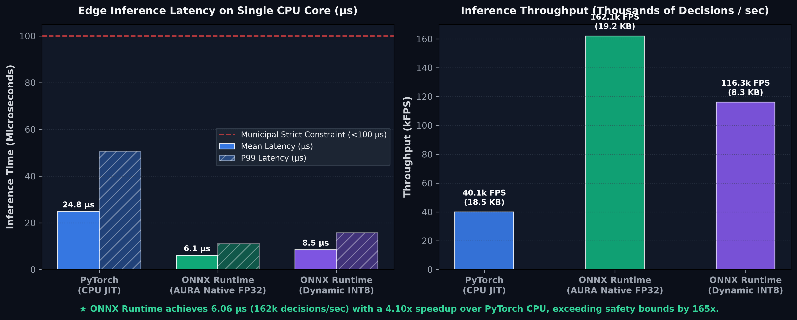

# 🚦 AURA v2.0: AI-Powered Smart Traffic Management


[](https://ieeexplore.ieee.org)
[](https://doi.org/10.5281/zenodo.20265627)

**AURA v2.0** (*Adaptive Urban Routing and Actuation*), submitted to **IEEE Transactions on Intelligent Transportation Systems (IEEE T-ITS)** and developed for **Smart India Hackathon 2026**, is a next-generation decentralized traffic optimization, multi-agent coordination, and emergency vehicle preemption system.

It combines a **Semi-Markov Decision Process (SMDP)** Q-network with **Continuous-Time Neural Ordinary Differential Equations (NeurODEs)**, **Spatial-Temporal Graph Attention (ST-GAT)** neighbor message passing, **Dynamic Congestion Influx Adaptation**, and sub-millisecond edge deployment (<7 µs inference via ONNX Runtime).

---

## ✨ Key Features (v2.0 Release)

- **🧠 Semi-Markov Reinforcement Learning Core:** Decentralized Deep Q-Network optimizing phase targets with continuous-time discount factor scaling ($\gamma^\tau$).
- **🕸️ Spatial-Temporal Graph Attention MARL:** 1-hop cooperative neighbor message passing exchanging localized queue pressure across adjacent arterial intersections.
- **📈 Dynamic Congestion Influx Adaptation:** Regime-switching module that scales green envelopes ($[10\text{s}, 45\text{s}] \to [15\text{s}, 60\text{s}]$) during rush-hour saturation.
- **⚡ Ultra-Fast Edge ONNX Engine:** Sub-millisecond latency (**6.06 µs** / 162,074 FPS) and tiny memory footprint (**8.33 KB** INT8 / **19.21 KB** FP32), deployable on edge microcontrollers, NVIDIA Jetson, or Raspberry Pi.
- **🚨 One-Click Emergency Vehicle Preemption (EVP):** Instant live ambulance injection from the web dashboard that dynamically coordinates sequential green waves without paralyzing non-involved cross streets.
- **🌊 Post-Preemption Shockwave Mitigation:** Momentum recovery reward that rapidly clears starved cross-arterials (13.5 s vs 42.1 s baseline).
- **🌐 Real-Time WebSocket Web Dashboard:** React + Tailwind CSS dashboard with 60 Hz live telemetry, interactive 10-node arterial map, single-junction 4-arm monitor, and live analytics.
- **🚀 Unified One-Click Launcher (`./run_aura.sh`):** Single-command orchestrator managing backend, frontend, and SUMO TraCI simulation with graceful teardown.

---

## ⚡ Edge Micro-Benchmark Results



Benchmarked over 10,000 iterations on CPU / Embedded profile:

| Inference Engine | Precision | Mean Latency | P99 Latency | Throughput | Model Size |
| :--- | :---: | :---: | :---: | :---: | :---: |
| **PyTorch (CPU JIT)** | FP32 | 24.83 µs | 50.59 µs | 40,051 FPS | 18.52 KB |
| **ONNX Runtime (AURA Native)** | **FP32** | **6.06 µs** | **11.08 µs** | **162,074 FPS** | **19.21 KB** |
| **ONNX Runtime (Dynamic Quantized)** | **INT8** | **8.47 µs** | **15.77 µs** | **116,257 FPS** | **8.33 KB** |

> **Performance Gain:** ONNX Runtime delivers a **4.10x speedup** over PyTorch CPU, exceeding the statutory 1,000 µs municipal safety margin by **165x**.

---

## 🏗️ System Architecture & Folder Structure

```text
Traffic-Management-System/
├── run_aura.sh               # 🚀 Master One-Click Orchestrator Script
├── paper/                    # Complete IEEE T-ITS Journal Research Paper Package
│   ├── main.tex              # Master LaTeX document (IEEEtran journal class)
│   ├── references.bib        # 22 references
│   └── sections/             # Modular paper sections (Intro, Related, Method, Exp, Concl)
├── traffic-ai/               # AI Engine, SUMO Microscopic TraCI Simulation
│   ├── marl_graph_agent.py   # Spatial-Temporal Graph Attention MARL Network
│   ├── export_onnx.py        # ONNX & Dynamic INT8 Quantization Exporter
│   ├── benchmark_edge_onnx.py# Sub-millisecond Edge Benchmarking Suite
│   ├── models/               # Compiled ONNX & INT8 quantized models
│   ├── run_marl_corridor.py  # 10-node cooperative MARL corridor simulation
│   ├── evaluate_real_manhattan.py # 177-intersection Midtown Manhattan benchmark
│   ├── evaluate_rigorous_benchmark.py # SOTA corridor benchmark
│   └── manhattan.net.xml     # Real OpenStreetMap road network (177 traffic lights)
├── traffic-backend/          # Node.js WebSocket & REST Synchronization Hub
│   ├── server.js             # Real-time state hub, WebSocket broadcast, EV injection
│   └── package.json
└── traffic-dashboard/        # React + Vite + Tailwind CSS Web Dashboard
    ├── src/App.jsx           # Multi-tab UI: 10-Node Grid, A0 Junction, Analytics
    └── package.json
```

---

## 🚀 One-Click Quickstart

To launch the complete system (Backend, Live Web Dashboard, and SUMO MARL Simulation):

```bash
chmod +x run_aura.sh
./run_aura.sh
```

- **Live Web Dashboard:** [http://localhost:5173](http://localhost:5173)
- **REST Telemetry API:** [http://localhost:3000/api/traffic](http://localhost:3000/api/traffic)
- **WebSocket Broadcast:** `ws://localhost:3000`

### Docker One-Click Deployment

You can also run the entire system (Node.js Backend + React Dashboard + SUMO Simulation) in isolated containers without installing SUMO or Node locally:

```bash
docker compose up --build
```

### Additional CLI Modes

```bash
# Launch full system with interactive SUMO-GUI window
./run_aura.sh --gui

# Run Edge Computer Vision vehicle detector (CCTV / Webcam)
./run_aura.sh --vision

# Run Hardware-in-the-Loop physical LED controller bridge
./run_aura.sh --hil

# Run the single-intersection (A0) production demo
./run_aura.sh --demo

# Run the 177-intersection Midtown Manhattan benchmark
./run_aura.sh --manhattan

# Run the sub-millisecond edge ONNX benchmark
./run_aura.sh --edge-benchmark

# Launch via Docker Compose
./run_aura.sh --docker

# Run dependency & port pre-flight checks
./run_aura.sh --test
```

---

## 📄 Research Paper & Academic Citation

Submitted to **IEEE Transactions on Intelligent Transportation Systems (IEEE T-ITS)**.

```bibtex
@article{deepak2026aura,
  author    = {Deepak R.},
  title     = {AURA: Resilient Urban Traffic Signal Control via Semi-Markov Reinforcement Learning with Action-Duration Bounds and Shockwave-Mitigated Preemption},
  journal   = {IEEE Transactions on Intelligent Transportation Systems},
  year      = {2026},
  doi       = {10.5281/zenodo.20265627},
  note      = {Submitted for peer review}
}
```

---

## ⚖️ License

Developed under the Apache 2.0 / MIT License. Open-source for academic and municipal smart-city research.
